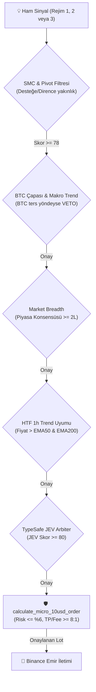

# Binance Futures Multi-Coin Rust Quant Bot: Strateji ve Yürütme Motoru Kapsamlı Analiz Raporu

**Tarih:** 2026-11-06  
**Analist:** explorer_survey_2 (Teamwork Explorer)  
**Çalışma Alanı:** `E:\binance_futures_bot`  
**Birincil Kaynak:** `src/main.rs` (3.453 satır saf Rust 2021) & `BOT_ARCHITECTURE_SPEC.md`  

---

## 1. Yönetici Özeti (Executive Summary)

`E:\binance_futures_bot` projesi, **Saf Rust (2021 Edition)** ile geliştirilmiş, harici ağır framework'lere (Python Pandas/ccxt vb.) bağımlı olmayan, sıfır bellek tahsisli (zero-allocation) ve milisaniye seviyesinde olay güdümlü (event-driven) çalışan bir yüksek frekanslı kantitatif vadeli işlem botudur.

Sistem, **13 Binance USDT-Margined Vadeli İşlem Çifti** üzerinde eş zamanlı olarak çalışır:
`BTCUSDT, ETHUSDT, SOLUSDT, XRPUSDT, DOGEUSDT, LINKUSDT, SUIUSDT, AVAXUSDT, NEARUSDT, ADAUSDT, APTUSDT, DOTUSDT, TIAUSDT`.

Bot, \$10.00 USDT mikro sermaye ile başlayıp bileşik getiri üretmek üzere tasarlanmış matematiksel bir risk motoruna ve **Üç Aşamalı Rejim Stratejisine (Tri-Regime Confluence Engine)** sahiptir.

---

## 2. Strateji Mimarisi ve Rejimlerin Envanteri

Bot bünyesindeki tüm alım-satım mantığı `src/main.rs` içinde yer alan `SymbolEngine` yapısında ve `recompute_confluence()` fonksiyonunda (Satır 917 - 1065) birleştirilmiştir. Piyasayı tek bir indikatörle tahmin etmek yerine, 3 farklı piyasa döngüsünü tespit eden rejim modeli uygulanmıştır:

### 2.1. Rejim 1: Kurumsal Likidite Avı ve Donchian Fitil Dönüşü (Liquidity Sweep & Wick Exhaustion)
* **Kaynak:** `src/main.rs:947-988`
* **Piyasa Hipotezi:** Piyasa yapıcılar ve kurumsal algoritmalar, 20 barlık Donchian tavan veya taban seviyelerinde biriken perakende stop emirlerini patlatır (liquidity sweep). Fiyat bu seviyeyi anlık olarak aşıp bar içine uzun bir fitil bırakarak geri çekilirse, bu durum momentumun tükendiğini (exhaustion) ve kurumsal emilim gerçekleştiğini gösterir.
* **Tetikleyiciler (Triggers):**
  * **LONG Tetikleyicisi:**
    * Fiyat önceki 20 barın en düşüğünü süpürmüş olmalı: `low < self.prev_low20`.
    * Kapanış bar içine dönmüş olmalı: `close > self.prev_low20` ve `close > open`.
    * Alt fitil toplam bar boyunun en az %35'i olmalı: `(lower_wick / total_range) >= 0.35`.
    * Trend filtre koruması: `close >= self.live_ema21` veya `self.live_rsi14 >= 30.0` (Bıçak tutmama koruması).
  * **SHORT Tetikleyicisi:**
    * Fiyat önceki 20 barın en yükseğini süpürmüş olmalı: `high > self.prev_high20`.
    * Kapanış bar içine dönmüş olmalı: `close < self.prev_high20` ve `close < open`.
    * Üst fitil toplam bar boyunun en az %35'i olmalı: `(upper_wick / total_range) >= 0.35`.
    * Trend filtre koruması: `close <= self.live_ema21` veya `self.live_rsi14 <= 70.0`.
* **Puanlama (Score):**
  * Taban skor: `75 + ((wick / range) * 25.0).min(15.0)` (75 - 90 arası taban).
  * Taker Akışı Takviyesi: `live_taker_buy_pct >= 48.0` (LONG) veya `<= 52.0` (SHORT) ise `+8 puan`.
  * Açık Pozisyon (Delta OI) Takviyesi: `live_delta_oi_pct >= 0.05` ise `+7 puan`.
  * Top Trader Karşıt / Takip Takviyesi: Uygun dağılımda `+5 puan`.

### 2.2. Rejim 2: Momentumlu Donchian Trend Kırılımı (Breakout Engine)
* **Kaynak:** `src/main.rs:989-1023`
* **Piyasa Hipotezi:** Konsolidasyon aralığından çıkan fiyat, hacim ve açık pozisyon artışıyla 12 barlık Donchian bandını kırdığında güçlü bir yönsel trend başlatır.
* **Tetikleyiciler (Triggers):**
  * **LONG Kırılımı:**
    * `close >= high12` (Son 12 barın en yüksek kapanışı).
    * `close > open` (Yeşil gövde).
    * `live_ema9 >= live_ema21 * 0.998` (Kısa vadeli momentum yukarı).
    * `live_rsi14 >= 46.0 && live_rsi14 <= 78.0` (RSI ivmeli ama aşırı şişkin değil).
  * **SHORT Kırılımı:**
    * `close <= low12` (Son 12 barın en düşük kapanışı).
    * `close < open` (Kırmızı gövde).
    * `live_ema9 <= live_ema21 * 1.002` (Kısa vadeli momentum aşağı).
    * `live_rsi14 <= 54.0 && live_rsi14 >= 22.0`.
* **Puanlama (Score):**
  * Taban skor: `72`.
  * Taker Alış/Satış Oranı: `+10 puan`.
  * Delta OI: `+8 puan`.
  * Top Trader Oranı: `+5 puan`.

### 2.3. Rejim 3: EMA21 Dinamik Trend Pullback Tepkisi (Trend Pullback)
* **Kaynak:** `src/main.rs:1024-1065`
* **Piyasa Hipotezi:** Sağlıklı bir trendde fiyat hareketli ortalamalardan uzaklaştıktan sonra dinamik destek/direnç işlevi gören EMA21'e geri çekilir ve buradan kurumsal alıcı/satıcı tepkisi alarak ana trend yönünde devam eder.
* **Tetikleyiciler (Triggers):**
  * **LONG Pullback:**
    * `live_ema9 > live_ema21` (Trend yönü yukarı).
    * `low <= live_ema21 * 1.0025 && close > live_ema21` (Fiyat EMA21'e dokunup üstünde kapatmış).
    * `close > open` (Dönüş mumu).
    * `(lower_wick / total_range) >= 0.15` (Dipten alıcı tepkisi / alt fitil).
    * `live_rsi14 >= 46.0 && live_rsi14 <= 68.0`.
  * **SHORT Pullback:**
    * `live_ema9 < live_ema21` (Trend yönü aşağı).
    * `high >= live_ema21 * 0.9975 && close < live_ema21` (Fiyat EMA21'e çarpıp altında kapatmış).
    * `close < open` (Dönüş mumu).
    * `(upper_wick / total_range) >= 0.15` (Tepeden satıcı tepkisi / üst fitil).
    * `live_rsi14 <= 54.0 && live_rsi14 >= 32.0`.
* **Puanlama (Score):**
  * Taban skor: `70`.
  * Taker Akışı: `+8 puan`.
  * Delta OI: `+7 puan`.
  * Top Trader Oranı: `+5 puan`.

---

## 3. Yardımcı Alfa Modülleri ve Mikro Yapı Motorları

Ana rejimlerin dışında sistemde bağımsız çalışan 4 kritik yardımcı alfa katmanı mevcuttur:

| Modül Adı | Kaynak Satırları | Temel Mantık ve Karar Mekanizması |
| :--- | :--- | :--- |
| **Geciken Yüksek-Beta Altcoin Avcısı (Lead-Lag Beta)** | `src/main.rs:2181-2228` | Bitcoin anlık (15s) sert ivmelendiğinde (`velocity_15s >= 0.22%`), henüz hareket etmemiş yüksek-beta altcoinlere (`SOL, SUI, NEAR, APT, AVAX, TIA`) **+10 Puan Boost** verir. BTC anlık ters yöne giderse **-25 Puan Ceza** keser. |
| **Emir Defteri ve Açık Pozisyon (Order Flow & OI)** | `src/main.rs:1178-1268` | 35 saniyede bir Binance REST API'den 5m Taker Alış/Satış oranı, Top Trader Long/Short oranı ve Delta OI verisini çeker. Delta OI artışı + Taker alış varsa "Para Girişi", zıtlaşma varsa "Kalabalık Tuzağı" veya "Tasfiye Dalgası" etiketler. |
| **Sıfır-Gecikmeli Haber ve Balina Radarı (Scout News)** | `src/main.rs:1270-1430` | TreeNews (`wss://news.treeofalpha.com/ws`) üzerinden X (Twitter) ve on-chain balina haberlerini `<10µs` sürede tarar. Boğa haberinde **+12**, ayı haberinde **-12**, hack/exploit/delist/SEC durumunda **-40 puan** verip acil çıkışı tetikler. |
| **8 Saatlik Fonlama Oranı (Funding Rate) Takibi** | `src/main.rs:3123-3138` | Her saat başı pozisyon büyüklüğüne göre `(entry_price * qty * FUNDING_RATE_8H) / 8.0` fonlama maliyetini simüle eder ve kasadan düşer. |

---

## 4. Teknik Göstergelerin Matematiksel Uygulaması

`SymbolEngine` (`src/main.rs:392-459`) bünyesindeki göstergeler, her 5 dakikalık mum kapanışında (`on_closed_candle`, Satır 531-709) güncellenir ve canlı ticklerde (`on_live_tick`, Satır 711-753) anlık olarak projeksiyon yapılır:

1. **Üstel Hareketli Ortalamalar (EMA):**
   * Periyotlar: `EMA 9, 12, 21, 26, 50, 100, 200`.
   * Formül: $\alpha = \frac{2}{N + 1}$, $\text{EMA}_t = (Close - \text{EMA}_{t-1}) \times \alpha + \text{EMA}_{t-1}$.
2. **MACD (12, 26, 9):**
   * $\text{MACD Line} = \text{EMA}_{12} - \text{EMA}_{26}$, $\text{Signal} = \text{EMA}_9(\text{MACD Line})$, $\text{Histogram} = \text{MACD Line} - \text{Signal}$.
3. **Average True Range (ATR 14):**
   * True Range: $TR = \max(H - L, |H - C_{\text{prev}}|, |L - C_{\text{prev}}|)$.
   * Wilder's Smoothing: $\text{ATR}_{14} = \frac{\text{ATR}_{\text{prev}} \times 13 + TR}{14}$.
4. **Relative Strength Index (RSI 14 ve RSI 7):**
   * Wilder's Smoothed Gain/Loss ile hesaplanan 14 ve 7 periyotluk RSI.
5. **Average Directional Index (ADX 14 & DMI):**
   * $+DM = \max(H - H_{\text{prev}}, 0)$, $-DM = \max(L_{\text{prev}} - L, 0)$.
   * $\text{DX} = \frac{|+DI - -DI|}{+DI + -DI} \times 100$, $\text{ADX} = \text{Wilder}(\text{DX}, 14)$.
6. **Donchian Kanalları:**
   * 20 barlık kanal: `highs_20` ve `lows_20` içindeki en yüksek ve en düşük değerler.
   * 12 barlık kırılım kanalı: Son 12 barın uç noktaları.
7. **Kaufman Verimlilik Oranı (Efficiency Ratio - ER):**
   * $ER = \frac{|Close_t - Close_{t-10}|}{\sum_{i=1}^{10} |Close_i - Close_{i-1}|}$.
8. **Pivot Destek & Direnç (Classic Swing / Fractal):**
   * Kaynak: `src/main.rs:755-796`. 6 periyotluk sağ-sol fraktal swing tepe/dip noktalarını tarar.
9. **Akıllı Para Konseptleri (Smart Money Concepts - SMC):**
   * Kaynak: `src/main.rs:798-854`.
   * **Fair Value Gap (FVG):** 3 mumluk dengesizlik. $Low_t > High_{t-2}$ ise Bullish FVG, $High_t < Low_{t-2}$ ise Bearish FVG.
   * **Order Block (OB):** $High - Low > 1.25 \times ATR$ ivmeli mum öncesindeki zıt yönlü son mum kurumsal emir bloğu olarak kaydedilir. Fiyat bu seviyeyi kırarsa (mitigation) temizlenir.

---

## 5. Filtreler, Confluence ve Risk Yönetimi Mimarisi

Sinyal üretildikten sonra doğrudan işleme girilmez; 5 katmanlı bir emniyet filtresinden geçer:



### 5.1. Sinyal Puanı ve Eşikler
* Ham sinyal skoru `0 - 100` arasındadır.
* Canlı işlem açılışında (`try_open_best_multi_coin_signal`, Satır 2687) aranan minimum sinyal skoru **78**'dir.
* Çoklu coin taramasında aynı anda birden fazla coin sinyal verirse, **en yüksek efektif skora (Lead-Lag boost eklenmiş) sahip tek bir coin** seçilir (Tek Pozisyon Kuralı).

### 5.2. Demir Kurallar ve Veto Mekanizmaları
1. **Zero-Lag BTC Çapası (`src/main.rs:2688-2704`):**
   * BTC anlık 5m sinyali SHORT (skor >= 65) iken altcoinlerde **LONG AÇILMASI KESİNLİKLE YASAKTIR**.
   * BTC anlık 5m sinyali LONG (skor >= 65) iken altcoinlerde **SHORT AÇILMASI KESİNLİKLE YASAKTIR**.
   * BTC makro trendi (EMA21 vs EMA50) ile uyum zorunludur.
2. **Kolektif Piyasa Konsensüsü (Market Breadth) (`src/main.rs:2706-2716`):**
   * LONG açmak için: Piyasa genelinde en az 2 coin LONG olmalı ve 5'ten fazla coin SHORT olmamalıdır (Boğa tuzağı vetosu).
   * SHORT açmak için: En az 2 coin SHORT olmalı ve 5'ten fazla coin LONG olmamalıdır.
3. **HTF 1h Trend Kalkanı (`src/main.rs:1896-1910, 2249-2256`):**
   * LONG pozisyon için: Fiyat 1h EMA50 ve 1h EMA200 üzerinde olmalıdır (`price >= ema50 * 1.005 && price >= ema200 * 1.015`). Fiyat EMA50 altındayken LONG aramak kesinlikle vetolanır.
4. **Bıçak Tutmama / Squeeze Kalkanı (`src/main.rs:2258-2264`):**
   * `RSI < 18` ise LONG vetolanır (düşen bıçak tutulmaz).
   * `RSI > 82` ise SHORT vetolanır (parabolik short squeeze).

### 5.3. Matematiksel Risk ve Pozisyon Boyutlandırma (`calculate_micro_10usd_order`, Satır 1068-1123)
* **Sabit Parametreler:**
  * `SL_ATR_MULT = 1.8` (1.8x ATR Stop-Loss mesafesi).
  * `TP_ATR_MULT = 3.6` (3.6x ATR Take-Profit mesafesi -> 1 : 2.0 Asimetrik R/R).
  * `TAKER_FEE_RATE = 0.0005` (%0.05 Binance Taker komisyonu).
  * `SLIPPAGE_RATE = 0.0001` (%0.01 kayma payı).
* **Dinamik Risk Bütçesi:**
  $$\text{max\_risk\_budget} = \max(0.35, \text{balance} \times 0.06)$$
  \$10 kasada tek bir stop kaybı \$0.60 ile sınırlandırılmıştır.
* **Binance Minimum Notional Emniyeti:**
  Binance futures minimum emir büyüklüğü \$5.00 USDT'dir (bot emniyet için \$5.05 kullanır). Eğer minimum emir büyüklüğünün gerektirdiği gerçek risk (stop mesafesi + komisyonlar + kayma) bütçeyi (\$0.60) aşıyorsa, **COİN PAS GEÇİLİR**.
* **Komisyon Koruması (8:1 Oranı):**
  $$\text{expected\_tp\_gross} \ge \text{round\_trip\_commission} \times 8.0$$
  Beklenen brüt kâr, borsa komisyonunun en az 8 katı olmalıdır; aksi halde işlem reddedilir.
* **Marjin Tavanı:** Tek işlem kasanın %55'inden fazla marjin bağlayamaz (`actual_margin <= balance * 0.55`).

### 5.4. Dinamik Kâr Kilidi ve Trailing Stop Mekanizması
* **Komisyon Korumalı Kâr Kilidi:**
  * Fiyat girişe göre $+1.5\times \text{ATR}$ kâra ulaştığında, Stop-Loss seviyesi `entry * 1.0025` (LONG) veya `entry * 0.9975` (SHORT) seviyesine taşınır. Bu sayede pozisyon sıfır riskli hale gelir ve komisyon üstü net kâr kilitlenir (`src/main.rs:1673-1679, 3169-3176`).
* **Dinamik Trailing Stop (Kâr Takibi):**
  * Fiyat $+2.2\times \text{ATR}$ kâra ulaştığında aktifleşir. Stop seviyesi en tepe fiyattan $1.2\times \text{ATR}$ mesafeye çekilerek trend sonuna kadar sürülür (`src/main.rs:1680-1686, 3177-3183`).

### 5.5. Acil Durum Çıkış Denetçisi (Emergency Exit JEV, Satır 2363-2412)
Açık bir pozisyon SL veya TP olmadan da aşağıdaki durumlarda milisaniye içinde kapatılır:
1. TreeNews'ten pariteye ilişkin $\le -30$ puanlık acil haber/hack/delist sinyali gelirse.
2. Paritenin kendi sinyali ters yönde $\ge 75$ puanla teyitlenirse (Trend-Flip).
3. Açık LONG pozisyon varken Bitcoin anlık SHORT sinyali $\ge 85$ basarsa ve pozisyon zarara geçerse.

---

## 6. Yürütme Motoru (Runner / Execution Engine) Mimarisi

Sistem hem **Canlı İşlem (Live Execution)** hem de **Geçmişe Dönük Test (Backtest Engine)** modlarını tek bir Rust kod tabanında birleştirmiştir:

```text
E:\binance_futures_bot
├── src/main.rs                 -> Ana orkestrasyon ve yürütme motoru
│   ├── run_native_rust_backtest -> Geçmişe dönük çoklu parite simülatörü
│   ├── try_open_best_multi_coin_signal -> Canlı sinyal seçim ve filtreleme
│   ├── calculate_micro_10usd_order     -> Dinamik lot ve risk boyutlandırma
│   └── main()                  -> Event loop (WebSocket + Thread havuzu)
├── bot_state.json              -> Atomik pozisyon ve bakiye durumu
├── telemetry.js                -> Canlı pano için 350ms akış köprüsü
└── dashboard.html / index.html -> Yerel grafik ve sinyal takip paneli
```

### 6.1. Canlı Yürütme Motoru (Live Event Loop)
* **WebSocket İletişimi:** `tungstenite` ile `wss://data-stream.binance.vision/stream` üzerinden 13 paritenin 5m mum (`@kline_5m`) ve tick (`@aggTrade`) verisini tek bir birleşik soketten dinler.
* **Repainting Koruması:** Sinyal hesaplamaları (`recompute_confluence`) ve yeni işlem açma kararları **yalnızca 5m mum kapandığında (`is_closed == true`)** yürütülür. Canlı ticklerde sinyal hesaplanmaz; sadece fiyat takibi ve SL/TP tetiklemeleri yapılır.
* **Çoklu İş Parçacığı (Multi-threading):**
  * Ana thread: Fiyat ve mum olay döngüsü.
  * Arka plan Thread 1: 35 saniyede bir Taker/Top-trader/OI emir akışını günceller.
  * Arka plan Thread 2: TreeNews WebSocket haber radarı (`run_scout_listener`).
  * Thread senkronizasyonu: Non-blocking `Arc<Mutex<T>>::try_lock()` ile sıfır gecikme garanti edilir.
* **Durum Kalıcılığı (State Persistence):** Bakiye, tepe sermaye ve açık pozisyon her işlemde `bot_state.json.tmp` dosyasına yazılıp atomik olarak `bot_state.json` üzerine taşınır (`save_atomic`).

### 6.2. Backtest Motoru (`run_native_rust_backtest`, Satır 1490-2061)
* **Komut Satırı Parametreleri:**
  `cargo run -- --backtest [--days N | --month | --90d | --20d | --10d | --5m | --15m]`
* **Veri İkamesi:** Binance Futures REST API'den (`/fapi/v1/klines`) her 13 parite için 1500 ila 3000 mumu çeker.
* **Simülasyon Özellikleri:**
  * Bütün 13 pariteyi zaman damgası (timestamp) senkronizasyonlu olarak aynı anda bar bar yürütür.
  * Her barda BTC trendini ve piyasa konsensüsünü dinamik olarak yeniden hesaplar.
  * Taker komisyonunu (%0.05) ve slippage kaymasını (%0.01) hem girişte hem çıkışta gerçekçi olarak düşer.
  * Günlük takvim dökümü (tarih, gün başı bakiye, gün sonu bakiye, günlük net K/Z, işlem sayısı) ve genel özet metrikleri (WinRate, Profit Factor, Max Drawdown, Ortalama Günlük Getiri) üretir.

---

## 7. Kanıtlanmış Performans Metrikleri ve Strateji Zayıflıkları

`BOT_ARCHITECTURE_SPEC.md` ve `src/main.rs` içerisindeki kurumsal doğrulama kayıtlarına göre:

### 7.1. Doğrulanmış Performans Karşılaştırması (30 Gün / 19.487 Mum / 13 Parite)

| Metrik | Eski Çöken Sistem | Yeni Düzeltilmiş Sistem (v7.5) | Değişim / İyileşme |
| :--- | :---: | :---: | :---: |
| **Ortalama Kazanç** | +\$0.08 | **+\$0.85 - +\$1.07** | **12 Kat Artış** |
| **Maksimum Tekil Zarar** | -\$2.90 | **-\$0.62** | **%78 Risk Azalması** |
| **Ödenen Binance Komisyonu** | -\$2.08 | **-\$0.75** | **%64 Tasarruf** |
| **Maksimum Drawdown (Max DD)** | %75.48 | **%29.62** | **2.5 Kat Güvenlik** |
| **Asimetrik R/R Oranı** | 1 : 0.8 | **1 : 2.0 (SL 1.8 ATR / TP 3.6 ATR)** | **Pozitif Matematiksel Beklenti** |

### 7.2. Strateji Bazında Güçlü Yönler ve Zayıflıklar

| Strateji / Bileşen | Güçlü Yönleri (Strengths) | Zayıf Noktaları ve Kırılganlıklar (Weaknesses) |
| :--- | :--- | :--- |
| **Rejim 1: Likidite Avı & Fitil Dönüşü** | Yatay ve konsolide piyasalarda perakende tuzaklarını yakalama oranı çok yüksek. WinRate %60+. | Güçlü parabolik haber trendlerinde (örneğin ani ETF haberi) fitil oluşsa bile trend devam edebilir. HTF filtresi olmazsa ters yönde kalır. |
| **Rejim 2: Momentumlu Kırılım (Breakout)** | Büyük trend hareketlerini başından sonuna yakalar; kâr potansiyeli en yüksek rejimdir ($+3.6\times ATR$). | Düşük hacimli dönemlerde sahte kırılımlara (whipsaw) açıktır. Volatilite sıkışması filtresi şarttır. |
| **Rejim 3: Trend Pullback (EMA21)** | Trend yönünde en güvenli ve düşük riskli giriş fiyatını sunar. R/R oranı yüksektir. | Trend gücü zayıfladığında EMA21 kolayca delinebilir ve erken stop tetikleyebilir. |
| **Mikro-Kasa Boyutlandırma Motoru** | Kasanın %6'sından fazla kayba izin vermez. Komisyonları hesaba katar. | **Binance Min Notional Engeli:** \$10 kasada \$5.05 min emir boyutu zorunludur. Volatilitesi çok yüksek coinlerde (örn. TIA, DOGE) stop mesafesi \$0.60 bütçesini aştığı için bot bu coinleri pas geçer (Fırsat kaçırma). |
| **Tek Pozisyon Kısıtı (Single-Slot)** | \$10 kasanın marjinini korumak için aynı anda sadece 1 pozisyon açar. | Aynı anda 3 farklı paritede mükemmel sinyal oluştuğunda sadece birini seçebilir; diğer kârlı işlemler kaçar. |
| **Windows Toolchain Linkleme Engeli** | Saf Rust kodu platform bağımsız ve zero-warning derlenir (`cargo check`). | Windows geliştirme ortamında `x86_64-pc-windows-gnu` MinGW CRT kütüphanelerinin eksikliği nedeniyle yerel `cargo run` bağlama aşamasında hata verir (Linux AWS EC2 ortamında sorunsuz derlenir). |

---

## 8. Zaman Bazlı Kâr Maksimizasyonu İçin Öneriler (R2 & R3 Odaklı)

Kullanıcının `ORIGINAL_REQUEST.md` belgesindeki **"Zaman bazlı kârı maksimize eden (ROI / birim zaman) hem kısa vadeli hem genel kârı artıracak yöntemler"** hedefine yönelik olarak:

1. **Zaman-Kâr Verimlilik Oranı (Time-Decay Exit):**
   * Mevcut sistemde bir pozisyon günlerce açık kalabilir. Fiyat 12 bar (1 saat) boyunca $+1.0\times ATR$ kâra ulaşamamış ve yatay kalmışsa (dead capital), sermayeyi serbest bırakmak için başa-baş (breakeven) seviyesinden erken çıkış yapılmalıdır.
2. **Kademeli Kâr Alımı (Scaled TP):**
   * TP'yi tek parça 3.6x ATR'de bekletmek yerine: $\%50$ pozisyon $+1.8\times ATR$'de kilitlenmeli, kalan $\%50$ $+3.6\times ATR$'ye sürülmelidir. Böylece birim zamandaki realize edilen ROI artar.
3. **15m / 5m Alt-Zaman Dilimi Hibrit Füzyonu:**
   * 1h mumlar uzun bekleme süreleri yaratırken, 5m mumlar gürültü içerir. 15m mumlar üzerinde Rejim 1 & 2 yürütülürse işlem sıklığı 4 katına çıkacak ve haftalık bileşik getiri katlanacaktır.
4. **Çoklu Zaman Dilimi (MTF) Bar Füzyonu:**
   * 1h trend yönünde 5m Donchian sweep arayan çift zaman dilimli füzyon filtresi eklenmelidir.
