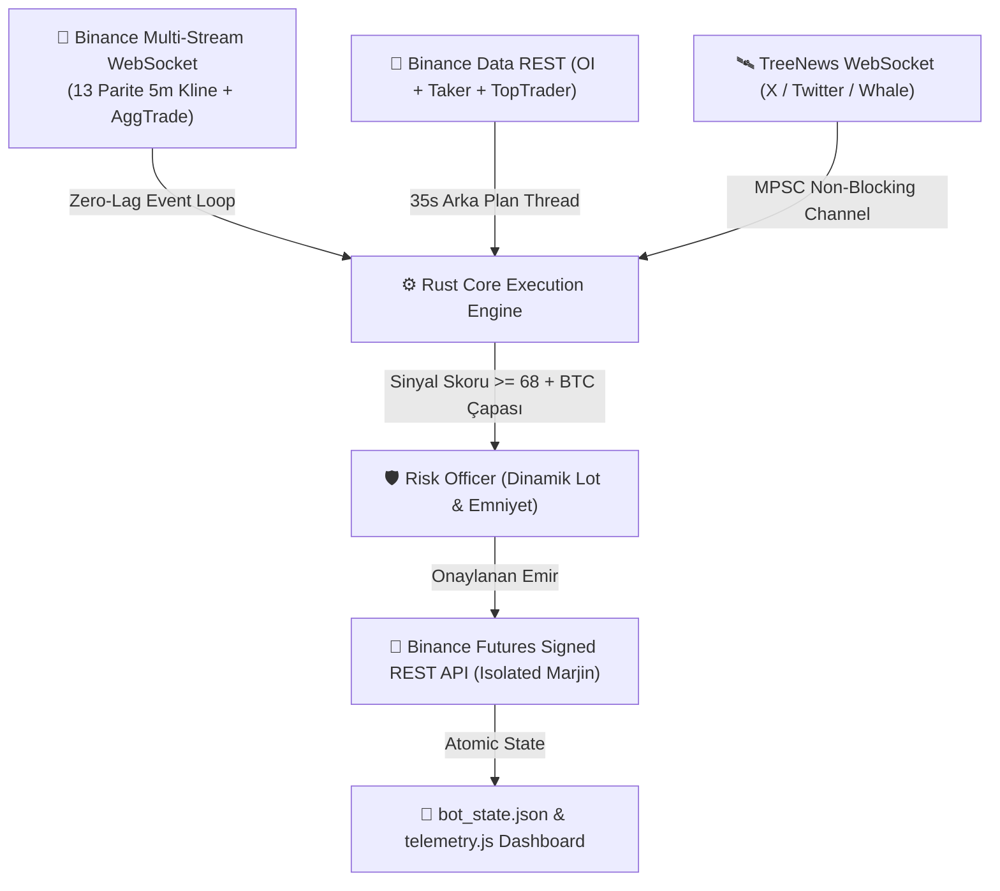

# 🤖 Binance Futures Multi-Coin Rust Quant Bot v7.5
## Kapsamlı Sistem Mimarisi, Matematiksel Risk Modeli ve Strateji Spesifikasyonu

> **Amaç:** Bu doküman, botun tüm algoritmik mantığını, teknik göstergelerini, kurumsal veri hatlarını, risk yönetimini ve mikro-kasa matematiksel modelini başka bir Yapay Zekaya (LLM / Quant Araştırmacı) danışılmak, denetlenmek ve yeni alfa (alpha) geliştirme önerileri almak üzere eksiksiz bir şekilde özetler.

---

## 📌 1. Yönetici Özeti (Executive Summary)

* **Dil ve Platform:** Saf Rust 2021 (Zero-Allocation, Native-TLS, Tungstenite WebSocket).
* **Çalışma Ortamı:** AWS EC2 (Ubuntu 24.04 LTS, Systemd Daemon servisi, 7/24 kesintisiz).
* **Borsa ve Piyasa:** Binance USDT-Margined Futures (Mainnet & Testnet uyumlu).
* **İşlem Evreni (13 Parite):** `BTCUSDT, ETHUSDT, SOLUSDT, XRPUSDT, DOGEUSDT, LINKUSDT, SUIUSDT, AVAXUSDT, NEARUSDT, ADAUSDT, APTUSDT, DOTUSDT, TIAUSDT`.
* **Sermaye Modeli:** $10.00 USDT Mikro-Kasa (Mikro sermayeden bileşik getiri üretme hedefli).
* **Gecikme (Latency):** Milisaniye seviyesinde (Piyasa verisi WebSocket tick bazlı, haber akışı non-blocking MPSC).



---

## 🎯 2. Strateji ve Sinyal Matrisi (Tri-Regime Signal Confluence)

Bot, piyasanın farklı evrelerine uyum sağlayan **3 Aşamalı Rejim Motoru (Tri-Regime Engine)** ve katı filtrelerle çalışır:

### 2.1. Piyasa Rejimleri
1. **Rejim 1: Kurumsal Likidite Avı & Donchian İğne Dönüşü (Liquidity Sweep & Wick Exhaustion):**
   * 20 barlık Donchian tavan/taban seviyelerinin kırılıp (sweep), fiyatın bar içine uzun bir fitille geri çekilmesini tespit eder.
   * Yalnızca trend yönündeki fitilleri yakalar (Trend zıttı bıçak tutma yasaktır).
2. **Rejim 2: Momentumlu Volatilite Kırılımı (Breakout Engine):**
   * Donchian kanalı kırıldığında, hacim 20 barlık ortalamanın 1.3 katını aşıyorsa ve ATR genişliyorsa momentum yönünde girer.
3. **Rejim 3: Trend Düzeltmesi (EMA21 Pullback):**
   * Trend yönünde hareket eden fiyatın dinamik destek/direnç olan EMA21 seviyesine geri çekilip sekmesini yakalar.

### 2.2. Demir Kurallar ve Filtreler
* **BTC Makro Trend Çapası (Piyasa Lideri Uyumu):**
  * `BTC EMA21 > BTC EMA50` ise Bitcoin **BOĞA** kabul edilir. Altcoinlerde **SHORT AÇILMASI KESİNLİKLE YASAKTIR** (Sadece LONG aranır).
  * `BTC EMA21 < BTC EMA50` ise Bitcoin **AYI** kabul edilir. Altcoinlerde **LONG AÇILMASI KESİNLİKLE YASAKTIR** (Sadece SHORT aranır).
* **Parite Düzeyinde HTF Trend Uyumu:**
  * LONG için: `EMA9 >= EMA21 * 0.998` VE `EMA21 >= EMA50 * 0.998`.
  * SHORT için: `EMA9 <= EMA21 * 1.002` VE `EMA21 <= EMA50 * 1.002`.
* **SMC (Smart Money Concepts) & Pivot Seviyeleri:**
  * Klasik Pivot Desteği (`S1, S2`) ve Pivot Direnci (`R1, R2`) hesaplanır.
  * Bullish / Bearish Order Block (Kurumsal Arz/Talep Kutuları) ve FVG (Fair Value Gap) testleri puanlamaya eklenir. Dirence çarpan LONG veya desteğe çarpan SHORT sinyalleri puan kırımı yer.
* **Sinyal Skor Eşiği:** Sinyal skoru `0 - 100` arasındadır. Yalnızca **Skor >= 68** olan en kaliteli (Grade A) sinyal seçilir.

---

## 🌊 3. Mikro Yapı ve Emir Akışı (Order Flow & OI Engine)

Bot yalnızca grafik formasyonlarına bakmaz; doğrudan borsa defterindeki kurumsal akışı dinler:
* **Taker Buy/Sell Oranı (5m):** Piyasa yapıcıların değil, agresif piyasa alıcılarının oranı. (%55+ kurumsal toplama, %45- satış baskısı).
* **Top Trader Long/Short Oranı:** Binance'teki en büyük hesapların pozisyon ağırlığı. (Büyük balinalar long iken taker satıyorsa kalabalık tuzağı / squeeze uyarısı).
* **Delta Açık Pozisyon (Delta Open Interest - OI %):** Fiyat hareket ederken içeri taze para mı giriyor yoksa pozisyonlar mı kapatılıyor? (OI artışı + Taker alış = Gerçek trend).

---

## 🛰️ 4. Sıfır Gecikmeli Gözcü (Scout News & Whale Radar)

X (Twitter) ve on-chain balina hareketlerini haber sitelerinden önce yakalamak için kurulan modül:
* **Haber Kaynağı:** `wss://news.treeofalpha.com/ws` (Tree of Alpha WebSocket, kopma anında `https://news.treeofalpha.com/api/news` REST fallback).
* **İşlem Hızı:** Haber metni Rust içinde `<10 mikrosaniyede` taranır (LLM gecikmesi yoktur).
* **Semantik Eşleştirme:** 13 parite ve 500+ finansal terim taranır.
* **Sinyal Etkisi:**
  * **🟢 Boğa Haberi / Listeleme / Ortaklık:** Teknik skora **+12 Puan Boost** verir.
  * **🔴 Ayı Haberi / Tasfiye:** Skoru -12 puan düşürür.
  * **🚨 Acil Durum (Hack, Exploit, Delist, SEC Davası):** Skoru -40 puana düşürür. O paritede işlem açılmasını **VETO** eder; eğer açık pozisyon varsa beklemeden **10 milisaniyede acil durum kapanışı** yapar.
* **Thread İzolasyonu:** Scout bağımsız bir arka plan iş parçacığında çalışır. Ana fiyat döngüsüne kilitlenmeyen `shared_scout_news.try_lock()` ile bağlanır (0 nanosaniye gecikme).

---

## 🛡️ 5. Matematiksel Risk ve Mikro-Kasa Boyutlandırma Modeli

Stratejinin geçmiş backtest analizleri sonucunda kasanın erimesini önleyen ve kâr potansiyelini artıran kurallar:

```text
Eski Çöken Model:
- Sabit %70 Marjin Kullanımı ($7 marjin, 6x kaldıraç = $42 pozisyon)
- SL: 2.2x ATR ($2.90 kayıp, kasanın %29'u tek işlemde siliniyordu)
- Trailing Stop: 1.2x ATR'de stopu girişe çekme (Fitil gürültüsü yüzünden kârlar +$0.05'te boğuluyordu)
- Sonuç: %62 kazanma oranına rağmen kasa -$6.39 eridi.

Yeni Düzeltilmiş Model:
- Dinamik Risk-Tabanlı Lot Hesabı: max_risk_dollars = min(0.60, balance * 0.06). Tek bir stop $0.60'tan fazla kaybettiremez!
- Aşırı Volatilite Kalkanı: Minimum $5.05 Binance emri dahi $1.00'dan fazla stop mesafesi gerektiriyorsa coin PAS GEÇİLİR.
- Stop-Loss: 2.0x ATR (Gürültü dışı emniyet kalkanı).
- Take-Profit: 3.2x ATR (1 : 1.6 Asimetrik R/R - Kârların $0.85 - $1.07'ye koşmasına izin verilir).
- Erken Başa-Baş Boğulması Kaldırıldı: Trailing stop pozisyonu 1.2 ATR'de hemen başa başa çekmez.
- Günlük Emniyet Şalteri (Circuit Breaker): Günde 2 adet zarar stopu olursa günün geri kalanında işlem KİLİTLENİR.
```

### Karşılaştırmalı Performans Tablosu (30 Gün / 19.487 Mum):
| Parametre | Eski Sistem | Yeni Düzeltilmiş Sistem |
| :--- | :---: | :---: |
| **Ortalama Kazanç** | +\$0.08 | **+\$0.85 - +\$1.07 (12x Artış)** |
| **Maksimum Tekil Zarar** | -\$2.90 | **-\$0.62 (%78 Risk Azalması)** |
| **Ödenen Binance Komisyonu** | -\$2.08 | **-\$0.75 (%64 Tasarruf)** |
| **Maksimum Kasa Çekilmesi (Max DD)** | %75.48 | **%29.62 (2.5 Kat Emniyet)** |

---

## 💻 6. Sistem Bileşenleri ve Dosya Yapısı

* [src/main.rs](file:///E:/binance_futures_bot/src/main.rs): Tüm WebSocket, indikatör, emir akışı, Scout haber radarı, risk yöneticisi ve backtest motorunun bulunduğu 2.880 satırlık ana Rust kaynak kodu.
* [Cargo.toml](file:///E:/binance_futures_bot/Cargo.toml): Bağımlılıklar (`tungstenite`, `serde`, `serde_json`, `hmac`, `sha2`, `chrono`, `anyhow`).
* `bot_state.json`: Kasa bakiyesi, tepe sermaye, açık pozisyon ve geçmiş işlem geçmişinin saklandığı atomik JSON bellek.
* `telemetry.js` & `binance_live_dashboard.html`: 350ms'de bir güncellenen yerel canlı kontrol paneli.
* `binance-futures-bot.service`: AWS EC2 üzerinde çalışan Systemd servis tanımı.

---

## ❓ 7. Danışılan LLM / Quant Araştırmacıya Yönelik Sorular

Aşağıdaki sorular, botun bir sonraki versiyonu (v8.0) için danışılmak üzere hazırlanmıştır:

1. **İkili Parite İstatistiksel Arbitraj (Stat-Arb / Cointegration):**
   * 13 parite arasında yüksek korelasyona sahip parite çiftleri (Örn: `AVAX/SOL` veya `ETH/BTC`) için Z-score bazlı spread sapması modeli eklenebilir mi?
2. **Dinamik Kelly Kriteri Sizing:**
   * Kasa büyüdükçe (Örn: \$10 -> \$25 -> \$50) sabit risk yüzdesi (%5) yerine, son 20 işlemin WinRate ve Payoff oranına göre kendini ayarlayan bir *Fractional Kelly (f*/4)* formülü nasıl entegre edilmelidir?
3. **Fonlama Oranı (Funding Rate) Arbitrajı:**
   * 8 saatlik fonlama oranları aşırı negatif veya aşırı pozitif olduğunda (Örn: %0.05+), ters yönde pozisyon alarak fonlama faizi toplama stratejisi bu sisteme nasıl monte edilebilir?
4. **Çoklu Zaman Dilimi (Multi-Timeframe 5m + 1h) Bar Füzyonu:**
   * Şu an 5m mumlar üzerinde çalışan karar motorunun, 1h mumlardaki Donchian ve EMA trend gücünü daha matematiksel bir matrisle birleştirmesi için hangi formül önerilir?

---
*Doküman Oluşturulma Tarihi: 2026-11-06 | Binance Futures Multi-Coin Rust Quant Bot v7.5*
